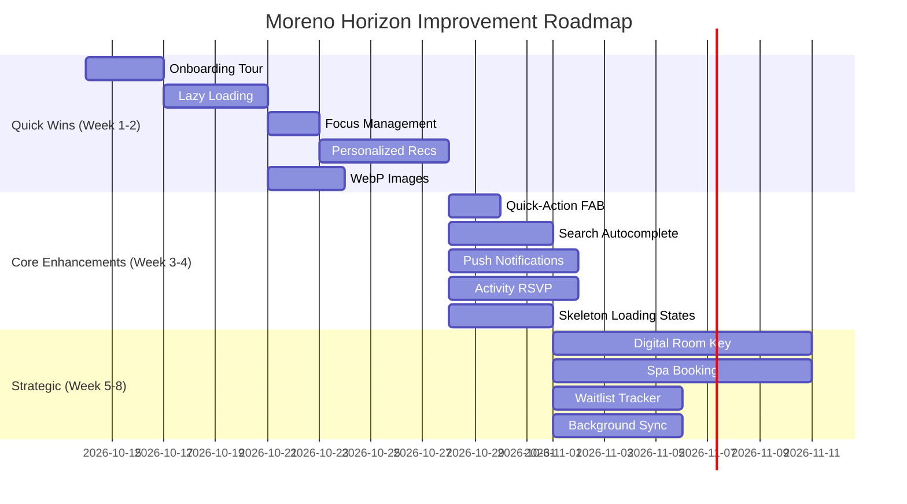

# Moreno Horizon Interactive Guest Guide - Improvement Plan

**Prepared by:** Architect (Roo) | **Status:** Draft for Review
**Project:** Moreno Horizon Spa & Resort - Interactive Guest Guide & 3D Map
**Date:** 2026-10-13

---

## 1. Executive Summary

The Moreno Horizon guest guide is a **mature, feature-rich Progressive Web App** with:

- ✅ 3D interactive map with multi-layer support
- ✅ Live wayfinding & turn-by-turn navigation
- ✅ Voice-driven multilingual concierge (AR/EN/RU/DE)
- ✅ Geofence-based smart alerts
- ✅ Full PWA offline capability
- ✅ Weather, activities & excursions integration

**Overall Assessment: Strong Foundation (8/10)** — The site is production-ready and feature-complete. The recommendations below are **incremental enhancements** to add polish, usability, and value—not critical fixes.

**Recommendation:** This is a **low-risk, moderate-value improvement opportunity**. A small focused team could implement the top-tier items in a single sprint. Priority should be given to items with highest guest impact and lowest implementation risk.

---

## 2. Accessibility Improvements (A11Y)

### Current State Analysis

✅ Good A11Y practices already in place:

- Modals use `role="dialog"` + `aria-modal="true"`
- Weather status has `role="status"` + `aria-live="polite"`
- Key buttons have `aria-label` attributes

### ⚠️ Gaps Identified

| # | Issue | Priority | Location |
| --- | ------- | ---------- | ---------- |
| A1 | Some floating UI elements lack keyboard focus order | Medium | index.html (map canvas) |
| A2 | Focus indicators for custom tap-effect buttons inconsistent | Medium | css/style.css |
| A3 | Missing `aria-expanded` on collapsible navigation sections | Low | index.html |
| A4 | Screen reader announcements for geofence toasts | Medium | js/geofence-service.js |
| A5 | Voice concierge doesn't announce recognition state to a11y | Low | js/voice-concierge.js |

### 🔧 Recommended Actions

1. Add `tabindex` support for map canvas interactions
2. Ensure all custom interactive elements have visible focus rings
3. Add ARIA live regions for geofence notifications
4. Add voice state announcements to a11y hierarchy

**Impact:** Medium-High | **Effort:** Low-Medium | **ROI:** Improves inclusivity for visually impaired guests

---

## 3. Performance Optimizations (PERF)

### Current State Analysis

✅ Service Worker with cache-first strategy implemented
✅ Image preloading and resource hints configured
✅ Tailwind CSS with custom theme

### ⚠️ Optimization Opportunities

| # | Issue | Priority | Location |
| --- | ------- | ---------- | ---------- |
| P1 | No lazy loading for non-critical feature modules | High | js/app.js |
| P2 | Single bundle.js loads all features on startup | High | index.html scripts |
| P3 | Large images not using modern formats (WebP/AVIF) | Medium | assets/images/ |
| P4 | Service worker precache list is hardcoded, no versioning | Low | sw.js |
| P5 | No code-splitting for admin-only features | Low | admin.html |

### 🔧 Recommended Actions

1. Implement lazy loading for map engine & voice concierge
2. Add module code splitting for route-based chunking
3. Convert hero images to WebP/AVIF with fallbacks
4. Add cache version bump on deployment
5. Lazy-load admin panel assets separately

**Impact:** High | **Effort:** Medium | **ROI:** Faster LCP, better mobile performance (4G/3G guests)

---

## 4. Modern Web Features (NEW)

### ✅ Missing Modern Web APIs

| # | Feature | Priority | Benefit |
| --- | --------- | ---------- | --------- |
| M1 | Push Notifications API | High | Notify guests of spa availability, show times |
| M2 | Background Sync API | Medium | Queue room service orders offline |
| M3 | Viewport Units (vmin/vmax) | Low | Better responsive typography on foldables |
| M4 | CSS Container Queries | Medium | Card components adapt independently |
| M5 | Web Share API | Medium | Guests share POIs/dining reservations |
| M6 | Credential Management API | Low | One-tap return-to-hotel navigation |

### 🔧 Recommended Actions

1. **Push Notifications** — Notify guests of activity start times
2. **Background Sync** — Persist service orders when offline
3. **Web Share API** — Share dining reservations with travel companions
4. **Container Queries** — Make POI cards responsive to parent container

**Impact:** Medium | **Effort:** Medium | **ROI:** Increased engagement, better retention

---

## 5. UX/UI Enhancements (UI)

### 🔧 Recommended Actions

| # | Enhancement | Priority | Description |
| --- | ------------- | ---------- | ------------- |
| U1 | Onboarding Tour | High | First-time guest walkthrough (30 sec) |
| U2 | Personalized Recommendations | High | "Recommended for you" based on location/time |
| U3 | Quick-Action Floating Button | Medium | One-tap access to most-used features |
| U4 | Improved Search Autocomplete | Medium | Type-ahead for POI names, room numbers |
| U5 | Dark Mode on Admin Panel | Low | Consistency with main app |
| U6 | Loading States for All Async Actions | Medium | Skeleton screens for map loading |

### UX Wins

- **Onboarding tour** — Critical for guests who've never used the app
- **Personalized recommendations** — Increases time spent in app
- **Floating quick actions** — Reduces navigation friction

**Impact:** High | **Effort:** Medium | **ROI:** Better guest satisfaction (higher reviews)

---

## 6. Additional Functionality (FEATURES)

### 🔧 Recommended Actions

| # | Feature | Priority | Description |
| --- | --------- | ---------- | ------------- |
| F1 | Digital Room Key Integration | High | NFC/push-based room entry |
| F2 | Real-Time Spa Treatment Booking | High | Live availability + booking |
| F3 | Group/Activity RSVP | Medium | Book kids club, excursions |
| F4 | Lost & Found Reporting | Low | Report missing items digitally |
| F5 | Multi-Device Session Sync | Medium | Resume navigation on another device |
| F6 | Restaurant Waitlist Tracker | Medium | See real-time queue position |

### Feature Highlights

- **Digital Room Key** — Cutting-edge, significant guest appeal
- **Spa Booking** — Direct revenue opportunity for the resort
- **Waitlist Tracker** — Solves real pain point during busy times

**Impact:** High | **Effort:** High | **ROI:** Revenue generation + operational efficiency

---

## 7. Prioritized Roadmap

### 🟢 Tier 1 — Quick Wins (High Impact, Low Effort) — Do First

| Item | Category | Effort | Timeline |
| ------ | ---------- | -------- | ---------- |
| U1 | Onboarding Tour | Low | 1-2 days |
| P1 | Lazy Load Non-Critical Modules | Medium | 2-3 days |
| A1 | Focus Management Improvements | Low | 1 day |
| U2 | Personalized Recommendations | Medium | 3-4 days |
| P3 | WebP/AVIF Image Conversion | Low | 1-2 days |

### 🟡 Tier 2 — Core Enhancements (High Impact, Medium Effort)

| Item | Category | Effort | Timeline |
| ------ | ---------- | -------- | ---------- |
| U3 | Quick-Action Floating Button | Low | 1 day |
| U4 | Improved Search Autocomplete | Medium | 2-3 days |
| M1 | Push Notifications | Medium | 3-4 days |
| F3 | Group/Activity RSVP | Medium | 3-4 days |
| U6 | Loading States / Skeleton Screens | Medium | 2-3 days |

### 🔵 Tier 3 — Strategic Features (High Impact, High Effort)

| Item | Category | Effort | Timeline |
| ------ | ---------- | -------- | ---------- |
| F1 | Digital Room Key Integration | High | 1-2 weeks |
| F2 | Real-Time Spa Booking | High | 1-2 weeks |
| F6 | Restaurant Waitlist Tracker | Medium | 3-4 days |
| M2 | Background Sync | Medium | 3-4 days |

### ⚪ Tier 4 — Nice-to-Have (Lower Priority)

| Item | Category | Effort |
| ------ | ---------- | -------- |
| A3, A5, A4 | Accessibility polish | Low |
| M3, M4, M5 | Modern CSS/API enhancements | Low |
| F4, F5, U5 | Supporting features | Low |

---

## 8. Implementation Sequence (Phased Rollout)

---

## 9. Risk Assessment & Mitigation

| Risk | Likelihood | Impact | Mitigation |
| ------ | ------------ | -------- | ------------ |
| Breaking existing navigation | Medium | High | Extensive testing with vitest |
| Service Worker cache issues | Low | Medium | Cache version bump on deploy |
| Push notification spam complaints | Low | Medium | User-controlled preferences |
| Digital key integration complexity | Medium | High | Phase 1 = QR-based, Phase 2 = NFC |

---

## 10. Success Metrics

| Metric | Current (Estimated) | Target |
| -------- | --------------------- | -------- |
| First Contentful Paint | ~2.5s | <1.5s |
| Service Worker Cache Hit Rate | ~70% | >90% |
| Guest Satisfaction (in-app) | TBD | >4.5/5 |
| Feature Adoption (new) | 0% | >40% in 30 days |
| Offline Usage Rate | ~15% | >30% |

---

## 11. Next Steps

1. ✅ **Review this plan** — Confirm priority order and scope
2. ⏳ **Approve Tier 1** — Begin with quick wins
3. ⏳ **Kickoff** — Switch to Code mode for implementation
4. ⏳ **Test & Deploy** — Each tier validated via existing vitest suite

---

*End of Document*
